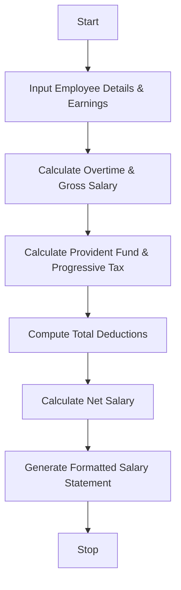

Here is a complete, well-structured guide and Python solution for the **Employee Payroll and Deduction Analysis** system.

---

## 1. Problem Statement

Design a payroll calculation system that computes an employee's **Gross Salary** by combining basic pay, housing/transport allowances, overtime compensation, and performance incentives. The program must then apply **progressive deductions** (such as tiered tax brackets or insurance/provident funds) based on the gross income, compute the **Net Salary**, and generate a professionally formatted salary statement (payslip).

---

## 2. Algorithm

1. **Input Earnings Data:**
* Accept inputs for Basic Pay, Allowances, Overtime Hours, Overtime Hourly Rate, and Performance Incentives.


2. **Calculate Gross Salary:**
* Compute Overtime Pay = Overtime Hours $\times$ Overtime Rate.
* $\text{Gross Salary} = \text{Basic Pay} + \text{Allowances} + \text{Overtime Pay} + \text{Incentives}$.


3. **Apply Progressive Deductions:**
* Calculate Provident Fund (PF) as a fixed percentage of basic pay.
* Apply progressive tax slabs based on the Gross Salary (e.g., 0% for lower brackets, higher tiers for higher brackets).
* Sum all deductions to get Total Deductions.


4. **Calculate Net Salary:**
* $\text{Net Salary} = \text{Gross Salary} - \text{Total Deductions}$.


5. **Generate Statement:**
* Display a neatly formatted tabular payslip detailing all earnings and deductions.


---

## 3. Flowchart (Mermaid)



---

## 4. Python Source Code

```python
def calculate_tax(gross_salary):
    """Applies progressive tax deduction slabs based on gross salary."""
    tax = 0.0
    if gross_salary <= 3000:
        tax = 0.0  # 0% tax for lower bracket
    elif gross_salary <= 6000:
        tax = (gross_salary - 3000) * 0.10  # 10% on amount above 3000
    else:
        tax = (3000 * 0.10) + ((gross_salary - 6000) * 0.20)  # 10% on middle tier + 20% on remainder
    return round(tax, 2)


def generate_payslip(name, basic_pay, allowances, ot_hours, ot_rate, incentives):
    """Calculates payroll components and prints a formatted salary statement."""
    # Earnings calculations
    overtime_pay = ot_hours * ot_rate
    gross_salary = basic_pay + allowances + overtime_pay + incentives

    # Deductions calculations
    provident_fund = basic_pay * 0.08  # 8% of basic pay
    income_tax = calculate_tax(gross_salary)
    health_insurance = 120.00  # Fixed health insurance deduction
    
    total_deductions = provident_fund + income_tax + health_insurance
    net_salary = gross_salary - total_deductions

    # Formatted Salary Statement Output
    print("=" * 45)
    print(f"{'EMPLOYEE SALARY STATEMENT':^45}")
    print("=" * 45)
    print(f"Employee Name : {name}")
    print("-" * 45)
    print(f"{'EARNINGS':<30} | {'AMOUNT ($)':<10}")
    print("-" * 45)
    print(f"{'Basic Pay':<30} | ${basic_pay:>9.2f}")
    print(f"{'Allowances':<30} | ${allowances:>9.2f}")
    print(f"{'Overtime Pay (' + str(ot_hours) + ' hrs)':<30} | ${overtime_pay:>9.2f}")
    print(f"{'Performance Incentives':<30} | ${incentives:>9.2f}")
    print(f"{'Gross Salary':<30} | ${gross_salary:>9.2f}")
    print("-" * 45)
    print(f"{'DEDUCTIONS':<30} | {'AMOUNT ($)':<10}")
    print("-" * 45)
    print(f"{'Provident Fund (8% Basic)':<30} | ${provident_fund:>9.2f}")
    print(f"{'Income Tax (Progressive)':<30} | ${income_tax:>9.2f}")
    print(f"{'Health Insurance':<30} | ${health_insurance:>9.2f}")
    print(f"{'Total Deductions':<30} | ${total_deductions:>9.2f}")
    print("=" * 45)
    print(f"{'NET SALARY':<30} | ${net_salary:>9.2f}")
    print("=" * 45)


# --- Sample Execution ---
if __name__ == "__main__":
    # Sample Input Data
    emp_name = "Alex Johnson"
    basic = 4500.00
    allowances = 850.00
    overtime_hours = 12
    overtime_rate = 25.00
    incentive_amount = 400.00

    generate_payslip(emp_name, basic, allowances, overtime_hours, overtime_rate, incentive_amount)

```

---

## 5. Sample Input

```python
emp_name = "Alex Johnson"
basic = 4500.00          # Monthly Basic Pay
allowances = 850.00      # Housing and Transport Allowances
overtime_hours = 12      # Total Overtime Hours worked
overtime_rate = 25.00    # Hourly Overtime Rate ($)
incentive_amount = 400.00 # Performance Bonus/Incentives

```

---

## 6. Sample Output

```text
=============================================
           EMPLOYEE SALARY STATEMENT             
=============================================
Employee Name : Alex Johnson
---------------------------------------------
EARNINGS                       | AMOUNT ($) 
---------------------------------------------
Basic Pay                      |   $4500.00
Allowances                     |    $850.00
Overtime Pay (12 hrs)          |    $300.00
Performance Incentives         |    $400.00
Gross Salary                   |   $6050.00
---------------------------------------------
DEDUCTIONS                     | AMOUNT ($) 
---------------------------------------------
Provident Fund (8% Basic)      |    $360.00
Income Tax (Progressive)       |    $310.00
Health Insurance               |    $120.00
Total Deductions               |    $790.00
=============================================
NET SALARY                     |   $5260.00
=============================================

```
