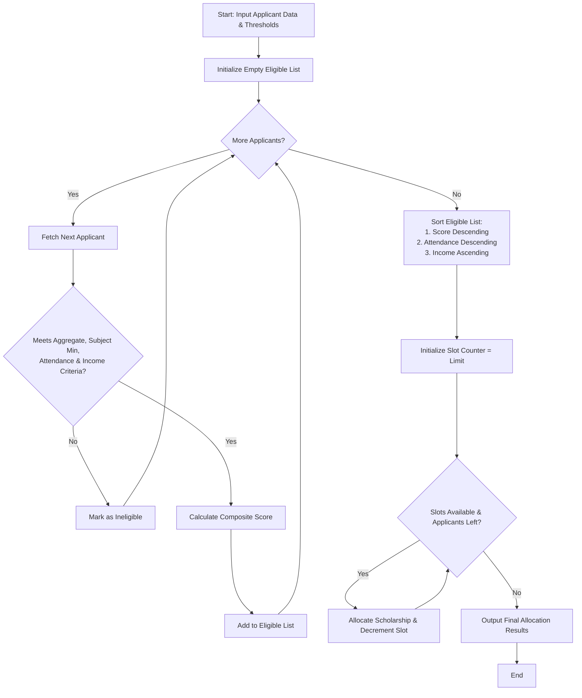

### Problem Statement

Design a robust **University Scholarship Allocation System** that automates the screening, ranking, and selection of scholarship candidates. The system must evaluate applicants based on multiple mandatory criteria:

1. **Aggregate Marks:** Must meet or exceed a specified percentage threshold.
2. **Subject-wise Minimums:** Every core subject score must meet or exceed a minimum threshold.
3. **Attendance:** Must meet or exceed a minimum attendance percentage.
4. **Income Criteria:** Annual family income must be below or equal to a specified limit.

Eligible applicants are assigned a **Composite Scholarship Score** and ranked. In the event of a tie (identical composite scores), the system must resolve ties deterministically using secondary criteria (higher attendance first, followed by lower family income). Finally, scholarships are allocated up to the maximum available capacity.

---

### Algorithm

1. **Input Collection:** Read applicant details including ID, name, aggregate marks, list of subject marks, attendance percentage, and annual income.
2. **Eligibility Filtering:** For each applicant, verify:
* $\text{Aggregate Marks} \ge \text{Min Aggregate Threshold}$
* $\text{All Subject Marks} \ge \text{Min Subject Threshold}$
* $\text{Attendance} \ge \text{Min Attendance Threshold}$
* $\text{Annual Income} \le \text{Max Income Threshold}$


3. **Score Calculation:** For eligible candidates, calculate a weighted Composite Score:

$$\text{Score} = (\text{Aggregate Marks} \times 0.6) + (\text{Attendance} \times 0.2) + \left(\left(1 - \frac{\text{Income}}{\text{Max Income Threshold}}\right) \times 100 \times 0.2\right)$$


4. **Multi-level Sorting & Tie-Resolution:** Sort eligible applicants using a multi-key comparator:
* Primary: Composite Score (Descending)
* Secondary: Attendance Percentage (Descending)
* Tertiary: Annual Income (Ascending)


5. **Allocation:** Iterate through the sorted list and allocate scholarships to the top $N$ candidates based on available scholarship slots.

---

### Flowchart



---

### Python Source Code

```python
class ScholarshipSystem:
    def __init__(self, min_aggregate=75.0, min_subject=60.0, min_attendance=85.0, max_income=600000, total_slots=3):
        self.min_aggregate = min_aggregate
        self.min_subject = min_subject
        self.min_attendance = min_attendance
        self.max_income = max_income
        self.total_slots = total_slots

    def evaluate_applicant(self, applicant):
        # 1. Check constraints
        if applicant['aggregate_marks'] < self.min_aggregate:
            return False, "Failed aggregate marks criteria"
        if any(mark < self.min_subject for mark in applicant['subject_marks']):
            return False, "Failed subject-wise minimum score criteria"
        if applicant['attendance'] < self.min_attendance:
            return False, "Failed attendance criteria"
        if applicant['income'] > self.max_income:
            return False, "Exceeds maximum income limit"
        
        return True, "Eligible"

    def calculate_score(self, applicant):
        # Weighted score: 60% Marks, 20% Attendance, 20% Need-based inverse income factor
        income_factor = max(0.0, 1.0 - (applicant['income'] / self.max_income))
        score = (applicant['aggregate_marks'] * 0.6) + \
                (applicant['attendance'] * 0.2) + \
                (income_factor * 100 * 0.2)
        return round(score, 2)

    def process_applications(self, applicants):
        eligible_pool = []

        for app in applicants:
            is_eligible, reason = self.evaluate_applicant(app)
            if is_eligible:
                score = self.calculate_score(app)
                eligible_pool.append({
                    'id': app['id'],
                    'name': app['name'],
                    'aggregate_marks': app['aggregate_marks'],
                    'attendance': app['attendance'],
                    'income': app['income'],
                    'score': score
                })

        # Sort by: 
        # 1. Composite Score (Descending)
        # 2. Attendance (Descending)
        # 3. Income (Ascending - lower income preferred in tie)
        eligible_pool.sort(key=lambda x: (-x['score'], -x['attendance'], x['income']))

        # Allocate slots
        allocated = []
        waitlisted = []
        
        for idx, candidate in enumerate(eligible_pool):
            if idx < self.total_slots:
                candidate['status'] = 'Awarded'
                allocated.append(candidate)
            else:
                candidate['status'] = 'Waitlisted'
                waitlisted.append(candidate)

        return allocated, waitlisted


# --- Sample Execution ---
if __name__ == "__main__":
    applicants_data = [
        {"id": "A101", "name": "Alice Smith", "aggregate_marks": 92.5, "subject_marks": [88, 95, 94], "attendance": 94.0, "income": 350000},
        {"id": "A102", "name": "Bob Jones", "aggregate_marks": 89.0, "subject_marks": [85, 90, 92], "attendance": 90.0, "income": 450000},
        {"id": "A103", "name": "Charlie Brown", "aggregate_marks": 74.0, "subject_marks": [70, 75, 78], "attendance": 95.0, "income": 200000}, # Fails aggregate
        {"id": "A104", "name": "Diana Prince", "aggregate_marks": 92.5, "subject_marks": [90, 93, 94], "attendance": 96.0, "income": 350000}, # Tie with Alice on marks, higher attendance
        {"id": "A105", "name": "Evan Wright", "aggregate_marks": 85.0, "subject_marks": [55, 90, 88], "attendance": 88.0, "income": 300000}, # Fails subject minimum (55)
    ]

    system = ScholarshipSystem(min_aggregate=75.0, min_subject=60.0, min_attendance=85.0, max_income=600000, total_slots=2)
    allocated, waitlisted = system.process_applications(applicants_data)

    print("=== SCHOLARSHIP ALLOCATION RESULTS ===")
    print("\n--- AWARDED ---")
    for student in allocated:
        print(f"ID: {student['id']} | Name: {student['name']} | Score: {student['score']} | Attendance: {student['attendance']}% | Income: ${student['income']}")

    print("\n--- WAITLISTED ---")
    for student in waitlisted:
        print(f"ID: {student['id']} | Name: {student['name']} | Score: {student['score']} | Status: {student['status']}")

```

---

### Sample Input

A list of applicant dictionaries containing academic metrics, attendance, and household income:

```json
[
  {"id": "A101", "name": "Alice Smith", "aggregate_marks": 92.5, "subject_marks": [88, 95, 94], "attendance": 94.0, "income": 350000},
  {"id": "A102", "name": "Bob Jones", "aggregate_marks": 89.0, "subject_marks": [85, 90, 92], "attendance": 90.0, "income": 450000},
  {"id": "A103", "name": "Charlie Brown", "aggregate_marks": 74.0, "subject_marks": [70, 75, 78], "attendance": 95.0, "income": 200000},
  {"id": "A104", "name": "Diana Prince", "aggregate_marks": 92.5, "subject_marks": [90, 93, 94], "attendance": 96.0, "income": 350000},
  {"id": "A105", "name": "Evan Wright", "aggregate_marks": 85.0, "subject_marks": [55, 90, 88], "attendance": 88.0, "income": 300000}
]

```

*(Thresholds: Min Aggregate = 75.0%, Min Subject = 60.0, Min Attendance = 85.0%, Max Income = $600,000, Total Slots = 2)*

---

### Sample Output

```text
=== SCHOLARSHIP ALLOCATION RESULTS ===

--- AWARDED ---
ID: A104 | Name: Diana Prince | Score: 93.3 | Attendance: 96.0% | Income: $350000
ID: A101 | Name: Alice Smith | Score: 92.9 | Attendance: 94.0% | Income: $350000

--- WAITLISTED ---
ID: A102 | Name: Bob Jones | Score: 89.4 | Status: Waitlisted

```


