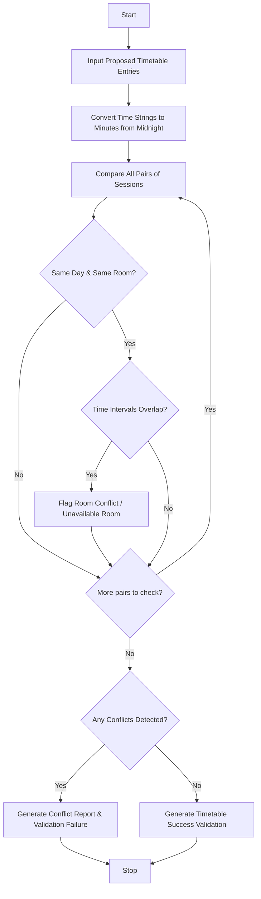

Here is a complete, well-structured guide and Python solution for the **Student Timetable Conflict Detection** system.

---

## 1. Problem Statement

Design an automated timetable validation program that reviews a proposed academic schedule containing course names, days, time intervals (represented as tuples or strings), and assigned rooms. The system must analyze the entries to detect overlapping time periods, identify room double-bookings (unavailable rooms), flag instructor or course conflicts, and validate whether the proposed timetable is free of scheduling errors.

---

## 2. Algorithm

1. **Input Timetable Data:**
* Accept a list of scheduled sessions, where each entry is represented as a tuple: `(course_name, day, start_time, end_time, room)`.


2. **Normalize Time Formats:**
* Convert time strings (e.g., `"09:00"`, `"10:30"`) into total minutes from midnight for easy numerical comparison.


3. **Detect Overlaps & Conflicts:**
* Iterate through every possible pair of scheduled sessions.
* Check if two sessions occur on the **same day** and in the **same room**.
* Check for time overlap using the interval overlap condition: $\max(\text{start}_1, \text{start}_2) < \min(\text{end}_1, \text{end}_2)$.


4. **Identify Unavailable Rooms:**
* Flag any room assigned to multiple concurrent sessions as an unavailable/conflicted resource.


5. **Generate Validation Report:**
* Output a clear summary of all detected conflicts or confirm that the timetable is fully valid.


---

## 3. Flowchart (Mermaid)



---

## 4. Python Source Code

```python
def time_to_minutes(time_str):
    """Converts 'HH:MM' string to total minutes from midnight."""
    hours, minutes = map(int, time_str.split(":"))
    return hours * 60 + minutes

def check_timetable_conflicts(schedule):
    """Detects time overlaps and room conflicts in a proposed timetable."""
    conflicts = []
    n = len(schedule)
    
    # Compare every pair of sessions
    for i in range(n):
        for j in range(i + 1, n):
            session1 = schedule[i]
            session2 = schedule[j]
            
            c1, day1, start1_str, end1_str, room1 = session1
            c2, day2, start2_str, end2_str, room2 = session2
            
            # Check if sessions are on the same day and in the same room
            if day1 == day2 and room1 == room2:
                s1 = time_to_minutes(start1_str)
                e1 = time_to_minutes(end1_str)
                s2 = time_to_minutes(start2_str)
                e2 = time_to_minutes(end2_str)
                
                # Overlap condition: max(start1, start2) < min(end1, end2)
                if max(s1, s2) < min(e1, e2):
                    conflicts.append({
                        "room": room1,
                        "day": day1,
                        "session_a": f"{c1} ({start1_str}-{end1_str})",
                        "session_b": f"{c2} ({start2_str}-{end2_str})"
                    })
                    
    # Generate Validation Report
    print("=" * 65)
    print(f"{'TIMETABLE CONFLICT DETECTION & VALIDATION REPORT':^65}")
    print("=" * 65)
    
    if conflicts:
        print(f"Status: ❌ VALIDATION FAILED ({len(conflicts)} conflict(s) found)\n")
        print(f"{'Room':<10} | {'Day':<10} | {'Conflicting Sessions'}")
        print("-" * 65)
        for conflict in conflicts:
            desc = f"{conflict['session_a']} vs {conflict['session_b']}"
            print(f"{conflict['room']:<10} | {conflict['day']:<10} | {desc}")
    else:
        print("Status: ✅ VALIDATION SUCCESSFUL (No scheduling conflicts found)")
        
    print("=" * 65)


# --- Sample Execution ---
if __name__ == "__main__":
    # Proposed timetable entries formatted as tuples:
    # (Course_Name, Day, Start_Time, End_Time, Room)
    proposed_schedule = [
        ("Data Structures", "Monday", "09:00", "10:30", "Room 101"),
        ("Database Systems", "Monday", "10:00", "11:30", "Room 101"),  # ⚠️ Overlaps with DS in Room 101
        ("Operating Systems", "Monday", "11:00", "12:30", "Room 102"), # Safe (Different room)
        ("Algorithms", "Tuesday", "13:00", "14:30", "Room 101"),
        ("Computer Networks", "Monday", "13:00", "14:30", "Room 101")  # Safe (Different time slot on Monday)
    ]

    check_timetable_conflicts(proposed_schedule)

```

---

## 5. Sample Input

```python
proposed_schedule = [
    ("Data Structures", "Monday", "09:00", "10:30", "Room 101"),
    ("Database Systems", "Monday", "10:00", "11:30", "Room 101"),  # Overlap in Room 101
    ("Operating Systems", "Monday", "11:00", "12:30", "Room 102"), # Different room
    ("Algorithms", "Tuesday", "13:00", "14:30", "Room 101"),
    ("Computer Networks", "Monday", "13:00", "14:30", "Room 101")  # Different time slot
]

```

---

## 6. Sample Output

```text
=================================================================
       TIMETABLE CONFLICT DETECTION & VALIDATION REPORT          
=================================================================
Status: ❌ VALIDATION FAILED (1 conflict(s) found)

Room       | Day        | Conflicting Sessions
-----------------------------------------------------------------
Room 101   | Monday     | Data Structures (09:00-10:30) vs Database Systems (10:00-11:30)
=================================================================

```
