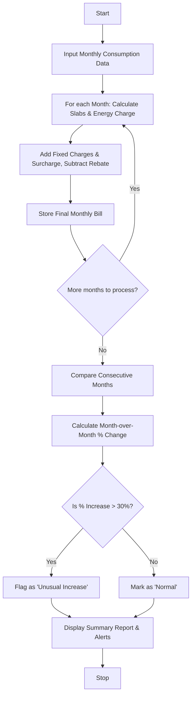

Here is a complete, well-structured guide and Python solution for the **Progressive Electricity Billing System**, complete with a problem statement, algorithm, Mermaid flowchart, Python code, and sample input/output.

---

## 1. Problem Statement

Design a program that calculates monthly household electricity bills using progressive consumption slabs, fixed service charges, surcharges, and rebates. Additionally, the system must compare electricity bills across multiple consecutive months, calculate the percentage change, and automatically flag any month with an **unusual increase** (e.g., greater than 30% compared to the previous month) to help users monitor energy consumption spikes.

---

## 2. Algorithm

1. **Initialize Rates & Rules:**
* Define consumption slabs (e.g., 0–100 units, 101–300 units, >300 units) with respective per-unit rates.
* Define fixed monthly charges, surcharge percentages, and eligibility criteria for rebates.


2. **Process Each Month's Consumption:**
* Compute energy charges progressively across the applicable slabs based on total units consumed.
* Add the fixed service charge to the energy charge.
* Calculate and add the percentage-based surcharge.
* Subtract any applicable rebates (e.g., for low consumption).
* Store the final calculated bill.


3. **Compare Across Months:**
* Loop through the historical monthly bills sequentially.
* Compute the month-over-month difference and percentage change: $\text{Percentage Change} = \frac{\text{Current Bill} - \text{Previous Bill}}{\text{Previous Bill}} \times 100$.
* If the percentage increase exceeds a threshold (e.g., 30%), tag the month as an **Unusual Increase**.


4. **Output Results:**
* Display a clean summary table showing units consumed, total bill amount, percentage change, and alert status for each month.


---

## 3. Flowchart (Mermaid)



---

## 4. Python Source Code

```python
def calculate_bill(units):
    """Calculates the progressive electricity bill based on slabs, fixed charges,

    surcharges, and rebates.
    """
    fixed_charge = 50.0
    surcharge_rate = 0.05  # 5% surcharge
    rebate = 15.0 if units <= 120 else 0.0  # Rebate for low usage

    energy_charge = 0.0
    if units <= 100:
        energy_charge = units * 3.50
    elif units <= 300:
        energy_charge = (100 * 3.50) + ((units - 100) * 5.00)
    else:
        energy_charge = (100 * 3.50) + (200 * 5.00) + ((units - 300) * 6.50)

    subtotal = energy_charge + fixed_charge
    surcharge = subtotal * surcharge_rate
    total_bill = subtotal + surcharge - rebate
    return round(total_bill, 2)


def analyze_electricity_bills(monthly_data):
    """Analyzes bills across multiple months and flags unusual increases."""
    prev_bill = None

    print(
        f"{'Month':<10} | {'Units':<8} | {'Bill ($)':<10} | {'Change (%)':<12} | {'Status'}"
    )
    print("-" * 65)

    for month, units in monthly_data.items():
        bill = calculate_bill(units)
        status = "Normal"
        pct_change = 0.0

        if prev_bill is not None and prev_bill > 0:
            pct_change = ((bill - prev_bill) / prev_bill) * 100
            if pct_change > 30.0:
                status = "⚠️ Unusual Increase"

        change_str = f"{pct_change:+.1f}%" if prev_bill is not None else "N/A"
        print(
            f"{month:<10} | {units:<8} | ${bill:<9.2f} | {change_str:<12} | {status}"
        )

        prev_bill = bill


# --- Sample Input ---
household_consumption = {
    "January": 110,
    "February": 105,
    "March": 240,
    "April": 430,  # Significant spike due to AC usage
    "May": 390,
}

if __name__ == "__main__":
    print("=== Progressive Electricity Billing & Trend Analysis ===")
    analyze_electricity_bills(household_consumption)

```

---

## 5. Sample Input

```python
household_consumption = {
    "January": 110,  # Low usage (receives rebate)
    "February": 105,  # Low usage (receives rebate)
    "March": 240,  # Moderate usage (Slab 2)
    "April": 430,  # High usage (Slab 3 - Summer spike)
    "May": 390,  # High usage (Slab 3)
}

```

---

## 6. Sample Output

```text
=== Progressive Electricity Billing & Trend Analysis ===
Month      | Units    | Bill ($)   | Change (%)   | Status
-----------------------------------------------------------------
January    | 110      | $417.38    | N/A          | Normal
February   | 105      | $412.12    | -1.3%        | Normal
March      | 240      | $976.50    | +137.0%      | ⚠️ Unusual Increase
April      | 430      | $2089.50   | +114.0%      | ⚠️ Unusual Increase
May        | 390      | $1879.50   | -10.0%       | Normal

```

---

Would you like to customize the consumption slab rates or add an automatic energy-saving recommendation feature based on these results?
