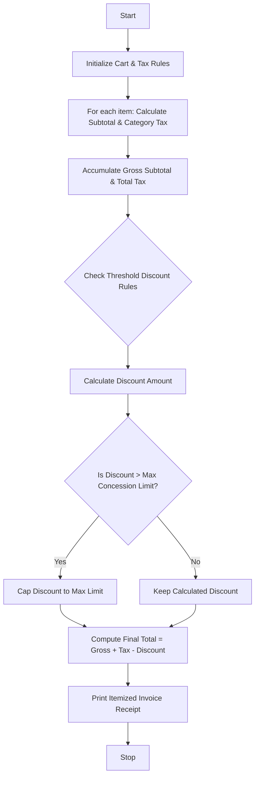

Here is a complete, well-structured guide and Python solution for the **Retail Billing System with Multiple Discount Rules**.

---

## 1. Problem Statement

Design an automated retail billing program that processes a shopping cart containing multiple products and quantities. The system must calculate category-specific taxes (e.g., higher rates for electronics, lower for clothing, zero for groceries), apply threshold-based cumulative discounts on the subtotal, enforce a maximum concession (discount) limit cap, and generate a clear, itemized invoice.

---

## 2. Algorithm

1. **Define Rules & Catalogs:**
* Set category tax rates (e.g., Electronics = 18%, Clothing = 5%, Groceries = 0%).
* Define threshold discount tiers (e.g., 12% discount if subtotal > $500, 5% if subtotal > $200).
* Set a maximum concession limit (cap) on discounts.


2. **Process Cart Items:**
* Iterate through each item in the cart.
* Calculate item subtotal ($\text{Unit Price} \times \text{Quantity}$).
* Determine applicable category tax and calculate item tax amount.
* Accumulate the Gross Subtotal and Total Tax.


3. **Apply Threshold Discounts & Caps:**
* Evaluate the Gross Subtotal against discount thresholds.
* If the calculated discount exceeds the maximum concession limit, cap it at the maximum allowed value.


4. **Calculate Final Total:**
* $\text{Final Total} = \text{Gross Subtotal} + \text{Total Tax} - \text{Applied Discount}$.


5. **Generate Invoice:**
* Print an itemized receipt showing item names, quantities, unit prices, subtotals, taxes, discount summaries, and the final payable amount.


---

## 3. Flowchart (Mermaid)



---

## 4. Python Source Code

```python
def generate_invoice(cart_items):
    # Category tax rates dictionary
    tax_rates = {
        "Electronics": 0.18,
        "Clothing": 0.05,
        "Groceries": 0.00,
        "Default": 0.10
    }
    
    subtotal = 0.0
    total_tax = 0.0
    itemized_details = []
    
    # Process each item in the cart
    for item in cart_items:
        name = item["name"]
        category = item.get("category", "Default")
        price = item["price"]
        qty = item["qty"]
        
        item_subtotal = price * qty
        tax_rate = tax_rates.get(category, tax_rates["Default"])
        item_tax = item_subtotal * tax_rate
        
        subtotal += item_subtotal
        total_tax += item_tax
        
        itemized_details.append({
            "name": name,
            "qty": qty,
            "price": price,
            "subtotal": item_subtotal,
            "tax": item_tax
        })
        
    # Threshold discount rules based on subtotal
    discount = 0.0
    if subtotal > 500:
        discount = subtotal * 0.12  # 12% discount for orders > $500
    elif subtotal > 200:
        discount = subtotal * 0.05  # 5% discount for orders > $200
        
    # Maximum concession limit cap
    max_concession = 75.00
    if discount > max_concession:
        discount = max_concession
        
    final_total = subtotal + total_tax - discount
    
    # Print Itemized Invoice
    print("=" * 65)
    print(f"{'RETAIL INVOICE RECEIPT':^65}")
    print("=" * 65)
    print(f"{'Item Name':<20} | {'Qty':<4} | {'Price':<7} | {'Subtotal':<9} | {'Tax':<7}")
    print("-" * 65)
    for it in itemized_details:
        print(f"{it['name']:<20} | {it['qty']:<4} | ${it['price']:<6.2f} | ${it['subtotal']:<8.2f} | ${it['tax']:<6.2f}")
    print("-" * 65)
    print(f"{'Gross Subtotal:':<45} ${subtotal:>15.2f}")
    print(f"{'Total Tax:':<45} ${total_tax:>15.2f}")
    print(f"{'Discount Applied (Capped at Max):':<45} -${discount:>14.2f}")
    print("=" * 65)
    print(f"{'FINAL TOTAL PAYABLE:':<45} ${final_total:>15.2f}")
    print("=" * 65)


# --- Sample Execution ---
if __name__ == "__main__":
    cart = [
        {"name": "Wireless Mouse", "category": "Electronics", "price": 45.00, "qty": 2},
        {"name": "Cotton T-Shirt", "category": "Clothing", "price": 20.00, "qty": 3},
        {"name": "Organic Rice (5kg)", "category": "Groceries", "price": 25.00, "qty": 2},
        {"name": "Bluetooth Speaker", "category": "Electronics", "price": 120.00, "qty": 1}
    ]
    generate_invoice(cart)

```

---

## 5. Sample Input

```python
cart = [
    {"name": "Wireless Mouse", "category": "Electronics", "price": 45.00, "qty": 2},
    {"name": "Cotton T-Shirt", "category": "Clothing", "price": 20.00, "qty": 3},
    {"name": "Organic Rice (5kg)", "category": "Groceries", "price": 25.00, "qty": 2},
    {"name": "Bluetooth Speaker", "category": "Electronics", "price": 120.00, "qty": 1}
]

```

---

## 6. Sample Output

```text
=================================================================
                     RETAIL INVOICE RECEIPT                      
=================================================================
Item Name            | Qty  | Price   | Subtotal  | Tax    
-----------------------------------------------------------------
Wireless Mouse       | 2    | $45.00  | $90.00    | $16.20 
Cotton T-Shirt       | 3    | $20.00  | $60.00    | $3.00  
Organic Rice (5kg)   | 2    | $25.00  | $50.00    | $0.00  
Bluetooth Speaker    | 1    | $120.00 | $120.00   | $21.60 
-----------------------------------------------------------------
Gross Subtotal:                                 $         320.00
Total Tax:                                      $          40.80
Discount Applied (Capped at Max):               -$         16.00
=================================================================
FINAL TOTAL PAYABLE:                            $         344.80
=================================================================

```
