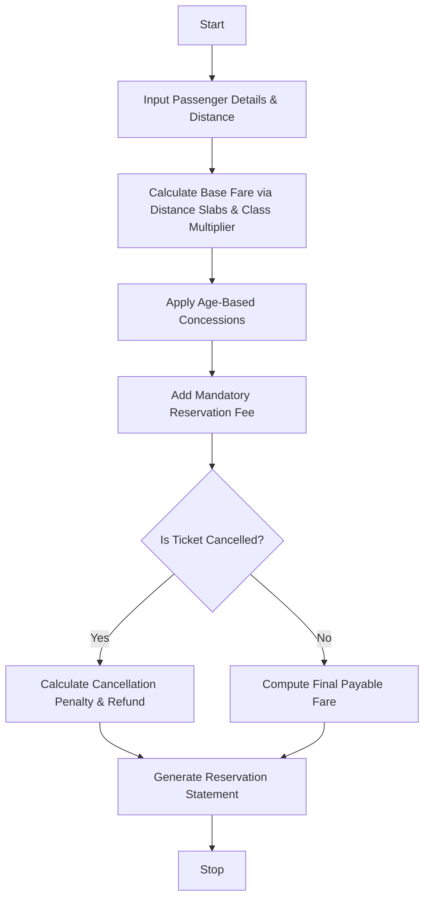

Here is a complete, well-structured guide and Python solution for the **Railway Fare and Reservation Calculator** system.

---

## 1. Problem Statement

Design an automated railway ticketing and fare calculation system that processes booking requests for multiple passengers. The system must compute base fares using distance slabs and travel classes (e.g., Sleeper, AC 3-Tier, AC 2-Tier), apply age-based concessions (such as discounts for children and senior citizens), add mandatory reservation and booking fees, and calculate cancellation penalties if a passenger cancels their ticket. Finally, it must generate a structured reservation statement.

---

## 2. Algorithm

1. **Input Passenger & Trip Data:**
* Accept passenger name, age, travel class, travel distance (in km), and cancellation status.


2. **Calculate Base Fare:**
* Determine rate-per-km based on distance slabs and apply a class multiplier (e.g., Sleeper = 1.0x, AC 3-Tier = 1.5x, AC 2-Tier = 2.0x).
* $\text{Base Fare} = \text{Distance} \times \text{Rate per KM} \times \text{Class Multiplier}$.


3. **Apply Age-Based Concessions:**
* Check passenger age. If under 5 years, fare is 0 (infant); if child (5–12), apply 50% discount; if senior citizen (60+), apply 40% discount; otherwise, standard fare.


4. **Add Reservation Fees & Handle Cancellations:**
* Add a fixed reservation fee per passenger.
* If the ticket is marked as cancelled, compute a cancellation penalty (e.g., flat fee or percentage of base fare) and determine the refund amount. Otherwise, compute the final payable fare.


5. **Generate Statement:**
* Display a formatted railway ticket and fare summary report.


---

## 3. Flowchart (Mermaid)



---

## 4. Python Source Code

```python
def calculate_passenger_fare(passenger):
    name = passenger["name"]
    age = passenger["age"]
    travel_class = passenger["class"]  # "Sleeper", "AC3", "AC2"
    distance = passenger["distance"]
    is_cancelled = passenger["cancelled"]

    # 1. Base fare calculation using distance slabs and class multipliers
    rate_per_km = 1.25
    class_multipliers = {"Sleeper": 1.0, "AC3": 1.6, "AC2": 2.2}
    multiplier = class_multipliers.get(travel_class, 1.0)

    base_fare = distance * rate_per_km * multiplier

    # 2. Age-based concessions
    concession_label = "Standard"
    discount_pct = 0.0

    if age < 5:
        discount_pct = 1.0  # Free for infants
        concession_label = "Infant (100% Off)"
    elif 5 <= age <= 12:
        discount_pct = 0.50  # 50% off for children
        concession_label = "Child (50% Off)"
    elif age >= 60:
        discount_pct = 0.40  # 40% off for senior citizens
        concession_label = "Senior Citizen (40% Off)"

    discounted_fare = base_fare * (1.0 - discount_pct)

    # 3. Reservation Fee
    reservation_fee = 30.0 if discount_pct < 1.0 else 0.0

    # 4. Cancellation & Refund logic
    total_amount = discounted_fare + reservation_fee
    penalty = 0.0
    refund = 0.0

    if is_cancelled:
        penalty = max(50.0, discounted_fare * 0.20)  # 20% penalty or min $50
        refund = max(0.0, total_amount - penalty)
        status = "CANCELLED"
    else:
        status = "CONFIRMED"

    return {
        "name": name,
        "age": age,
        "class": travel_class,
        "distance": distance,
        "base_fare": base_fare,
        "concession": concession_label,
        "reservation_fee": reservation_fee,
        "total": total_amount,
        "status": status,
        "penalty": penalty,
        "refund": refund,
    }


def generate_reservation_report(passengers):
    print("=" * 75)
    print(f"{'RAILWAY FARE & RESERVATION STATEMENT':^75}")
    print("=" * 75)

    for p in passengers:
        res = calculate_passenger_fare(p)
        print(f"Passenger Name : {res['name']} (Age: {res['age']})")
        print(f"Travel Class   : {res['class']} | Distance: {res['distance']} km")
        print(f"Concession     : {res['concession']}")
        print(f"Base Fare      : ${res['base_fare']:.2f} | Reservation Fee: ${res['reservation_fee']:.2f}")
        print(f"Status         : {res['status']}")

        if res["status"] == "CANCELLED":
            print(f"Cancellation Penalty: ${res['penalty']:.2f} | Refund Amount: ${res['refund']:.2f}")
        else:
            print(f"Final Payable  : ${res['total']:.2f}")
        print("-" * 75)


# --- Sample Input ---
if __name__ == "__main__":
    passenger_list = [
        {"name": "Robert Smith", "age": 45, "class": "AC3", "distance": 650, "cancelled": False},
        {"name": "Margaret Smith", "age": 62, "class": "AC3", "distance": 650, "cancelled": False},
        {"name": "Tommy Smith", "age": 8, "class": "Sleeper", "distance": 650, "cancelled": False},
        {"name": "David Clark", "age": 30, "class": "AC2", "distance": 1200, "cancelled": True},
    ]

    generate_reservation_report(passenger_list)

```

---

## 5. Sample Input

```python
passenger_list = [
    {"name": "Robert Smith", "age": 45, "class": "AC3", "distance": 650, "cancelled": False},
    {"name": "Margaret Smith", "age": 62, "class": "AC3", "distance": 650, "cancelled": False},
    {"name": "Tommy Smith", "age": 8, "class": "Sleeper", "distance": 650, "cancelled": False},
    {"name": "David Clark", "age": 30, "class": "AC2", "distance": 1200, "cancelled": True},
]

```

---

## 6. Sample Output

```text
===========================================================================
                   RAILWAY FARE & RESERVATION STATEMENT                    
===========================================================================
Passenger Name : Robert Smith (Age: 45)
Travel Class   : AC3 | Distance: 650 km
Concession     : Standard
Base Fare      : $1300.00 | Reservation Fee: $30.00
Status         : CONFIRMED
Final Payable  : $1330.00
---------------------------------------------------------------------------
Passenger Name : Margaret Smith (Age: 62)
Travel Class   : AC3 | Distance: 650 km
Concession     : Senior Citizen (40% Off)
Base Fare      : $1300.00 | Reservation Fee: $30.00
Status         : CONFIRMED
Final Payable  : $810.00
---------------------------------------------------------------------------
Passenger Name : Tommy Smith (Age: 8)
Travel Class   : Sleeper | Distance: 650 km
Concession     : Child (50% Off)
Base Fare      : $812.50 | Reservation Fee: $30.00
Status         : CONFIRMED
Final Payable  : $436.25
---------------------------------------------------------------------------
Passenger Name : David Clark (Age: 30)
Travel Class   : AC2 | Distance: 1200 km
Concession     : Standard
Base Fare      : $3300.00 | Reservation Fee: $30.00
Status         : CANCELLED
Cancellation Penalty: $660.00 | Refund Amount: $2670.00
---------------------------------------------------------------------------

```
