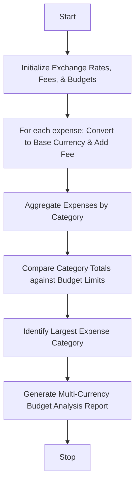

Here is a complete, well-structured guide and Python solution for the **Multi-Currency Travel Budget Analysis** system.

---

## 1. Problem Statement

Design an automated travel budget analysis program that processes trip expenses incurred in various foreign currencies. The system must convert each expense into a common base currency using supplied exchange rates, add applicable currency conversion fees, aggregate spending by category, compare actual category totals against planned budgets, and automatically identify the largest expense category.

---

## 2. Algorithm

1. **Initialize Rates & Budgets:**
* Define exchange rates relative to a base currency (e.g., USD).
* Set flat or percentage-based conversion fees for foreign transactions.
* Set target budget limits for each expense category (e.g., Accommodation, Food, Transport, Entertainment).


2. **Process and Convert Expenses:**
* Loop through each expense entry.
* Convert foreign currency amount to the base currency: $\text{Base Amount} = \text{Foreign Amount} \times \text{Exchange Rate}$.
* Add any applicable conversion fee.
* Accumulate totals per category.


3. **Compare Against Budget & Analyze:**
* Compare each category's total spending against its allocated budget to check if it's within budget or exceeded.
* Determine the category with the highest total expenditure.


4. **Generate Report:**
* Display an itemized summary comparing planned budget vs. actual spending, conversion fees paid, and highlight the largest expense category.


---

## 3. Flowchart (Mermaid)



---

## 4. Python Source Code

```python
def analyze_travel_budget(expenses, exchange_rates, conversion_fee_pct, category_budgets):
    category_totals = {cat: 0.0 for cat in category_budgets}
    total_conversion_fees = 0.0
    processed_expenses = []

    # 1. Convert currencies and aggregate by category
    for exp in expenses:
        foreign_amount = exp["amount"]
        currency = exp["currency"]
        category = exp["category"]
        
        rate = exchange_rates.get(currency, 1.0)
        base_amount = foreign_amount * rate
        fee = base_amount * conversion_fee_pct
        
        total_expense = base_amount + fee
        total_conversion_fees += fee
        
        if category in category_totals:
            category_totals[category] += total_expense
        else:
            category_totals[category] = total_expense
            
        processed_expenses.append({
            "description": exp["desc"],
            "foreign": f"{foreign_amount} {currency}",
            "converted": total_expense
        })

    # 2. Identify the largest expense category
    largest_category = max(category_totals, key=category_totals.get)
    overall_spent = sum(category_totals.values())
    total_budget = sum(category_budgets.values())

    # 3. Generate Report Output
    print("=" * 65)
    print(f"{'MULTI-CURRENCY TRAVEL BUDGET ANALYSIS':^65}")
    print("=" * 65)
    print(f"{'Category':<18} | {'Budget ($)':<11} | {'Actual ($)':<11} | {'Status'}")
    print("-" * 65)
    
    for cat, budget in category_budgets.items():
        actual = category_totals[cat]
        diff = budget - actual
        status = f"Under (${abs(diff):.2f})" if diff >= 0 else f"⚠️ Over (${abs(diff):.2f})"
        print(f"{cat:<18} | ${budget:<10.2f} | ${actual:<10.2f} | {status}")
        
    print("-" * 65)
    print(f"Total Conversion Fees Paid : ${total_conversion_fees:.2f}")
    print(f"Total Spent vs Total Budget: ${overall_spent:.2f} / ${total_budget:.2f}")
    print(f"Largest Expense Category   : 🌟 {largest_category} (${category_totals[largest_category]:.2f})")
    print("=" * 65)


# --- Sample Execution ---
if __name__ == "__main__":
    # Exchange rates relative to USD (Base Currency)
    rates = {
        "USD": 1.0,
        "EUR": 1.08,
        "JPY": 0.0065,
        "GBP": 1.28
    }
    
    conversion_fee = 0.025  # 2.5% foreign transaction fee
    
    budgets = {
        "Accommodation": 1200.00,
        "Food & Dining": 500.00,
        "Transport": 400.00,
        "Sightseeing": 300.00
    }
    
    travel_expenses = [
        {"desc": "Hotel in Paris", "amount": 950.0, "currency": "EUR", "category": "Accommodation"},
        {"desc": "Bullet Train Ticket", "amount": 42000.0, "currency": "JPY", "category": "Transport"},
        {"desc": "Dinner in Tokyo", "amount": 12000.0, "currency": "JPY", "category": "Food & Dining"},
        {"desc": "Museum Pass", "amount": 150.0, "currency": "EUR", "category": "Sightseeing"},
        {"desc": "Taxi Rides", "amount": 180.0, "currency": "USD", "category": "Transport"},
        {"desc": "Cafe & Snacks", "amount": 90.0, "currency": "GBP", "category": "Food & Dining"}
    ]

    analyze_travel_budget(travel_expenses, rates, conversion_fee, budgets)

```

---

## 5. Sample Input

```python
rates = {"USD": 1.0, "EUR": 1.08, "JPY": 0.0065, "GBP": 1.28}
conversion_fee = 0.025  # 2.5%

budgets = {
    "Accommodation": 1200.00,
    "Food & Dining": 500.00,
    "Transport": 400.00,
    "Sightseeing": 300.00
}

travel_expenses = [
    {"desc": "Hotel in Paris", "amount": 950.0, "currency": "EUR", "category": "Accommodation"},
    {"desc": "Bullet Train Ticket", "amount": 42000.0, "currency": "JPY", "category": "Transport"},
    {"desc": "Dinner in Tokyo", "amount": 12000.0, "currency": "JPY", "category": "Food & Dining"},
    {"desc": "Museum Pass", "amount": 150.0, "currency": "EUR", "category": "Sightseeing"},
    {"desc": "Taxi Rides", "amount": 180.0, "currency": "USD", "category": "Transport"},
    {"desc": "Cafe & Snacks", "amount": 90.0, "currency": "GBP", "category": "Food & Dining"}
]

```

---

## 6. Sample Output

```text
=================================================================
             MULTI-CURRENCY TRAVEL BUDGET ANALYSIS               
=================================================================
Category           | Budget ($)  | Actual ($)  | Status
-----------------------------------------------------------------
Accommodation      | $1200.00    | $1051.35    | Under ($148.65)
Food & Dining      | $500.00     | $185.01     | Under ($314.99)
Transport          | $400.00     | $471.74     | ⚠️ Over ($71.74)
Sightseeing        | $300.00     | $165.60     | Under ($134.40)
-----------------------------------------------------------------
Total Conversion Fees Paid : $46.43
Total Spent vs Total Budget: $1873.70 / $2400.00
Largest Expense Category   : 🌟 Accommodation ($1051.35)
=================================================================

```
