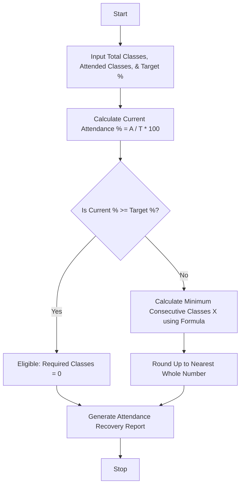

Here is a complete, well-structured guide and Python solution for the **Attendance Recovery Computation** system.

---

## 1. Problem Statement

Design an automated attendance tracking program that calculates a student's current attendance percentage against a specified institutional eligibility threshold (e.g., 75%). If a student's attendance falls below the target threshold, the system must automatically compute the minimum number of **consecutive future classes** the student needs to attend without missing any to successfully recover their attendance and meet eligibility.

---

## 2. Algorithm

1. **Input Attendance Data & Threshold:**
* Accept total classes conducted so far ($T$), classes attended so far ($A$), and the target eligibility percentage ($P_{target}$, e.g., 75%).


2. **Calculate Current Percentage:**
* Compute current attendance: $P_{current} = (A / T) \times 100$.


3. **Evaluate Eligibility:**
* If $P_{current} \ge P_{target}$, the student is already eligible. Required recovery classes = 0.


4. **Compute Required Consecutive Classes ($X$):**
* If $P_{current} < P_{target}$, solve for $X$ such that:

$$\frac{A + X}{T + X} \ge \frac{P_{target}}{100}$$


* Rearranging the formula yields:

$$X = \lceil \frac{(P_{target} \times T) - (100 \times A)}{100 - P_{target}} \rceil$$


* Use the ceiling function ($\lceil \ \rceil$) to ensure whole numbers of classes.


5. **Generate Report:**
* Display a structured summary table showing student stats, current percentages, required classes, and eligibility status.


---

## 3. Flowchart (Mermaid)



---

## 4. Python Source Code

```python
import math

def calculate_attendance_recovery(total_classes, attended_classes, target_pct):
    """Calculates current attendance and required consecutive classes to reach target."""
    current_pct = (attended_classes / total_classes) * 100 if total_classes > 0 else 0.0
    
    if current_pct >= target_pct:
        required_classes = 0
        status = "Eligible (Target Met)"
    else:
        # Formula: X = ceil( (target * total - 100 * attended) / (100 - target) )
        numerator = (target_pct * total_classes) - (100 * attended_classes)
        denominator = 100 - target_pct
        required_classes = math.ceil(numerator / denominator)
        status = "Shortage (Recovery Needed)"
        
    return {
        "total": total_classes,
        "attended": attended_classes,
        "current_pct": round(current_pct, 2),
        "target_pct": target_pct,
        "required": required_classes,
        "status": status
    }

def analyze_student_attendance(student_records, target_pct):
    """Generates a formatted attendance recovery report for multiple students."""
    print("=" * 75)
    print(f"{'ATTENDANCE RECOVERY & ELIGIBILITY REPORT (Target: ' + str(target_pct) + '%)':^75}")
    print("=" * 75)
    print(f"{'Student Name':<15} | {'Total':<6} | {'Attended':<8} | {'Current %':<10} | {'Required Classes':<16} | {'Status'}")
    print("-" * 75)
    
    for name, data in student_records.items():
        res = calculate_attendance_recovery(data["total"], data["attended"], target_pct)
        print(f"{name:<15} | {res['total']:<6} | {res['attended']:<8} | {res['current_pct']:<9.2f}% | {res['required']:<16} | {res['status']}")
        
    print("=" * 75)

# --- Sample Execution ---
if __name__ == "__main__":
    target_threshold = 75.0  # 75% minimum attendance required
    
    students = {
        "Alice Smith": {"total": 40, "attended": 32},   # 80.00% (Above target)
        "Bob Jones": {"total": 40, "attended": 26},     # 65.00% (Below target)
        "Charlie Brown": {"total": 50, "attended": 30}, # 60.00% (Below target)
        "Diana Prince": {"total": 45, "attended": 40}   # 88.89% (Above target)
    }
    
    analyze_student_attendance(students, target_threshold)

```

---

## 5. Sample Input

```python
target_threshold = 75.0  # Target eligibility percentage

students = {
    "Alice Smith": {"total": 40, "attended": 32},
    "Bob Jones": {"total": 40, "attended": 26},
    "Charlie Brown": {"total": 50, "attended": 30},
    "Diana Prince": {"total": 45, "attended": 40}
}

```

---

## 6. Sample Output

```text
===========================================================================
      ATTENDANCE RECOVERY & ELIGIBILITY REPORT (Target: 75.0%)             
===========================================================================
Student Name    | Total  | Attended | Current %  | Required Classes | Status
---------------------------------------------------------------------------
Alice Smith     | 40     | 32       | 80.00%     | 0                | Eligible (Target Met)
Bob Jones       | 40     | 26       | 65.00%     | 8                | Shortage (Recovery Needed)
Charlie Brown   | 50     | 30       | 60.00%     | 30               | Shortage (Recovery Needed)
Diana Prince    | 45     | 40       | 88.89%     | 0                | Eligible (Target Met)
===========================================================================

```
