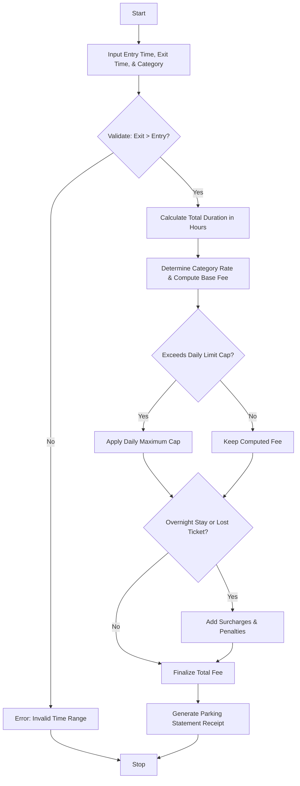

Here is a complete, well-structured guide and Python solution for the **Smart Parking Fee Management** system.

---

## 1. Problem Statement

Design an automated parking fee management program that validates vehicle entry and exit timestamps, calculates parking duration, and computes fees based on different vehicle categories (e.g., Motorcycle, Car, SUV). The system must handle overnight parking surcharges, enforce daily spending caps/limits, account for penalty conditions (such as a lost ticket fee), and generate an itemized parking ticket receipt.

---

## 2. Algorithm

1. **Validate Time Inputs:**
* Accept entry and exit timestamps. Verify that the exit time is strictly after the entry time. If invalid, display an error and abort.


2. **Calculate Duration:**
* Determine total duration in hours (including fractional hours).


3. **Determine Base Fees & Category Rates:**
* Look up the vehicle category hourly rate (e.g., Motorcycle = $2/hr, Car = $4/hr, SUV = $6/hr).
* Calculate initial fee = $\text{Duration} \times \text{Hourly Rate}$.


4. **Apply Daily Limits & Surcharges:**
* Cap the fee at a daily maximum limit if the duration spans multiple days or exceeds standard thresholds.
* Check if overnight parking occurred (e.g., staying past midnight) and add a flat overnight surcharge.


5. **Apply Penalty Conditions:**
* Check for special flags like a lost ticket and add the corresponding penalty fee.


6. **Generate Receipt:**
* Display a clean, itemized parking statement with breakdown details.


---

## 3. Flowchart (Mermaid)



---

## 4. Python Source Code

```python
from datetime import datetime

def calculate_parking_fee(entry_str, exit_str, category, lost_ticket=False, overnight=False):
    """Calculates parking fee based on time duration, vehicle category, surcharges, and penalties."""
    # 1. Validate and parse time inputs
    try:
        fmt = "%Y-%m-%d %H:%M"
        entry_time = datetime.strptime(entry_str, fmt)
        exit_time = datetime.strptime(exit_str, fmt)
    except ValueError:
        return {"error": "Invalid date/time format. Use 'YYYY-MM-DD HH:MM'."}
    
    if exit_time <= entry_time:
        return {"error": "Exit time must be strictly after entry time."}
    
    # 2. Calculate duration
    duration_delta = exit_time - entry_time
    duration_hours = duration_delta.total_seconds() / 3600.0
    
    # 3. Vehicle Category Rates and Daily Caps
    rates = {
        "Motorcycle": {"hourly": 2.00, "daily_cap": 15.00},
        "Car": {"hourly": 4.00, "daily_cap": 30.00},
        "SUV": {"hourly": 6.00, "daily_cap": 45.00}
    }
    
    cat_data = rates.get(category, rates["Car"])
    hourly_rate = cat_data["hourly"]
    daily_cap = cat_data["daily_cap"]
    
    # Calculate days and remaining hours for cap application
    days = duration_hours // 24
    rem_hours = duration_hours % 24
    
    base_fee = (days * daily_cap) + min(rem_hours * hourly_rate, daily_cap)
    
    # 4. Surcharges & Penalties
    overnight_fee = 10.00 if overnight else 0.00
    penalty_fee = 25.00 if lost_ticket else 0.00
    
    total_payable = base_fee + overnight_fee + penalty_fee
    
    return {
        "entry": entry_str,
        "exit": exit_str,
        "duration_hours": round(duration_hours, 2),
        "category": category,
        "base_fee": round(base_fee, 2),
        "overnight_fee": overnight_fee,
        "penalty_fee": penalty_fee,
        "total": round(total_payable, 2)
    }

def print_parking_receipt(ticket_info):
    if "error" in ticket_info:
        print(f"❌ Error: {ticket_info['error']}")
        return
    
    print("=" * 50)
    print(f"{'SMART PARKING RECEIPT':^50}")
    print("=" * 50)
    print(f"Vehicle Category : {ticket_info['category']}")
    print(f"Entry Time       : {ticket_info['entry']}")
    print(f"Exit Time        : {ticket_info['exit']}")
    print(f"Total Duration   : {ticket_info['duration_hours']} hours")
    print("-" * 50)
    print(f"{'Base Parking Fee':<35} ${ticket_info['base_fee']:>10.2f}")
    print(f"{'Overnight Surcharge':<35} ${ticket_info['overnight_fee']:>10.2f}")
    print(f"{'Lost Ticket Penalty':<35} ${ticket_info['penalty_fee']:>10.2f}")
    print("=" * 50)
    print(f"{'TOTAL PAYABLE':<35} ${ticket_info['total']:>10.2f}")
    print("=" * 50)


# --- Sample Execution ---
if __name__ == "__main__":
    # Sample Input
    entry = "2026-06-10 08:30"
    exit_t = "2026-06-10 14:15"
    vehicle_cat = "Car"
    is_overnight = False
    is_lost_ticket = False
    
    result = calculate_parking_fee(entry, exit_t, vehicle_cat, is_lost_ticket, is_overnight)
    print_parking_receipt(result)

```

---

## 5. Sample Input

```python
entry = "2026-06-10 08:30"
exit_t = "2026-06-10 14:15"
vehicle_cat = "Car"
is_overnight = False
is_lost_ticket = False

```

---

## 6. Sample Output

```text
==================================================
              SMART PARKING RECEIPT               
==================================================
Vehicle Category : Car
Entry Time       : 2026-06-10 08:30
Exit Time        : 2026-06-10 14:15
Total Duration   : 5.75 hours
--------------------------------------------------
Base Parking Fee                    $     23.00
Overnight Surcharge                 $      0.00
Lost Ticket Penalty                 $      0.00
==================================================
TOTAL PAYABLE                       $     23.00
==================================================

```
