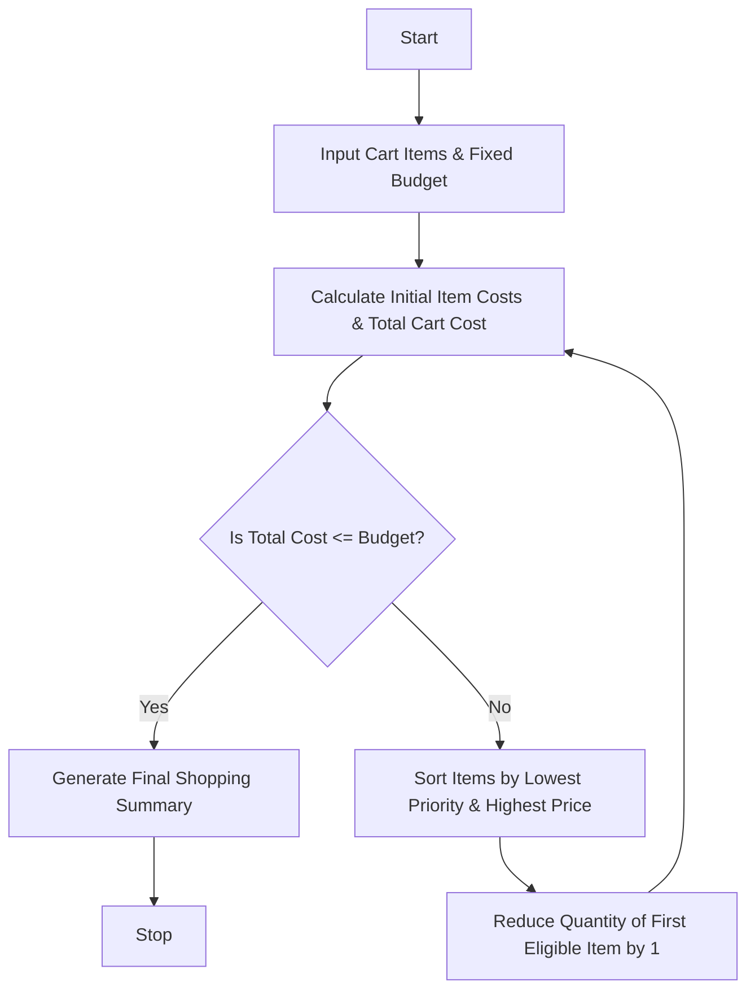

Here is a complete, well-structured guide and Python solution for the **Multi-Product Shopping Budget Constraint** system.

---

## 1. Problem Statement

Design an automated shopping assistant program that evaluates a shopping basket containing multiple products, quantities, and individual prices. The system must apply promotional discounts, compare the total expense against a user's **fixed budget**, and if the total exceeds the budget, intelligently scale down or remove quantities of lower-priority items until the purchase fits securely within the financial limit.

---

## 2. Algorithm

1. **Input Data:**
* Accept a fixed budget limit ($B$).
* Accept a list of cart items, each containing name, unit price, initial quantity, priority level (e.g., 1 = High/Essentials, 2 = Medium, 3 = Low/Optional), and discount percentage.


2. **Calculate Initial Totals:**
* For each item, compute the discounted item cost: $\text{Item Cost} = \text{Price} \times \text{Quantity} \times (1 - \text{Discount Rate})$.
* Sum all item costs to get the total cart expenditure.


3. **Evaluate Budget Constraint:**
* If Total Cost $\le$ Budget, no adjustments are needed.
* If Total Cost $>$ Budget, enter a reduction loop.


4. **Iterative Reduction Strategy:**
* Sort cart items by priority (lowest priority first, then highest unit price).
* Decrement the quantity of the lowest priority item by 1.
* Recalculate total cost. Repeat until Total Cost $\le$ Budget or all non-essential quantities reach zero.


5. **Generate Final Report:**
* Display the adjusted shopping list, quantities removed/reduced, and final payable amount.


---

## 3. Flowchart (Mermaid)



---

## 4. Python Source Code

```python
def evaluate_and_adjust_budget(budget, cart_items):
    """Evaluates cart against budget and reduces low-priority items if over budget."""
    
    def calculate_total_cost(items):
        total = 0.0
        for item in items:
            discounted_price = item["price"] * (1 - item.get("discount", 0.0))
            total += discounted_price * item["qty"]
        return round(total, 2)

    initial_cost = calculate_total_cost(cart_items)
    adjustments_made = []

    # Iteratively reduce quantities if over budget
    while calculate_total_cost(cart_items) > budget:
        # Sort items: Lowest priority first (highest priority number), then highest price
        eligible_items = [item for item in cart_items if item["qty"] > 0]
        if not eligible_items:
            break  # Cannot reduce further
        
        eligible_items.sort(key=lambda x: (x["priority"], -x["price"]), reverse=True)
        target = eligible_items[0]
        
        # Reduce quantity by 1
        target["qty"] -= 1
        adjustments_made.append(target["name"])

    final_cost = calculate_total_cost(cart_items)

    # Print Report
    print("=" * 65)
    print(f"{'MULTI-PRODUCT BUDGET CONSTRAINT ANALYSIS':^65}")
    print("=" * 65)
    print(f"Fixed Budget Target : ${budget:.2f}")
    print(f"Initial Cart Cost   : ${initial_cost:.2f}")
    print(f"Final Adjusted Cost : ${final_cost:.2f}")
    print("-" * 65)
    print(f"{'Item Name':<20} | {'Priority':<8} | {'Final Qty':<10} | {'Subtotal ($)'}")
    print("-" * 65)
    
    for item in cart_items:
        discounted_price = item["price"] * (1 - item.get("discount", 0.0))
        subtotal = discounted_price * item["qty"]
        print(f"{item['name']:<20} | {item['priority']:<8} | {item['qty']:<10} | ${subtotal:>10.2f}")
        
    print("=" * 65)
    if adjustments_made:
        print(f"⚠️ Budget exceeded! Quantities were automatically adjusted.")
    else:
        print(f"✅ Cart is within budget. No reductions needed.")
    print("=" * 65)


# --- Sample Execution ---
if __name__ == "__main__":
    fixed_budget = 150.00
    
    # Priority: 1 = Essential, 2 = Standard, 3 = Luxury/Optional
    shopping_cart = [
        {"name": "Whole Milk", "price": 4.50, "qty": 2, "priority": 1, "discount": 0.0},
        {"name": "Chicken Breast", "price": 12.00, "qty": 3, "priority": 1, "discount": 0.10},
        {"name": "Organic Berries", "price": 8.00, "qty": 4, "priority": 2, "discount": 0.0},
        {"name": "Craft Chocolate", "price": 15.00, "qty": 3, "priority": 3, "discount": 0.0},
        {"name": "Imported Wine", "price": 35.00, "qty": 1, "priority": 3, "discount": 0.0}
    ]

    evaluate_and_adjust_budget(fixed_budget, shopping_cart)

```

---

## 5. Sample Input

```python
fixed_budget = 150.00

shopping_cart = [
    {"name": "Whole Milk", "price": 4.50, "qty": 2, "priority": 1, "discount": 0.0},
    {"name": "Chicken Breast", "price": 12.00, "qty": 3, "priority": 1, "discount": 0.10},
    {"name": "Organic Berries", "price": 8.00, "qty": 4, "priority": 2, "discount": 0.0},
    {"name": "Craft Chocolate", "price": 15.00, "qty": 3, "priority": 3, "discount": 0.0},
    {"name": "Imported Wine", "price": 35.00, "qty": 1, "priority": 3, "discount": 0.0}
]

```

---

## 6. Sample Output

```text
=================================================================
             MULTI-PRODUCT BUDGET CONSTRAINT ANALYSIS            
=================================================================
Fixed Budget Target : $150.00
Initial Cart Cost   : $192.40
Final Adjusted Cost : $147.40
-----------------------------------------------------------------
Item Name            | Priority | Final Qty  | Subtotal ($)
-----------------------------------------------------------------
Whole Milk           | 1        | 2          |      $9.00
Chicken Breast       | 1        | 3          |     $32.40
Organic Berries      | 2        | 2          |     $16.00
Craft Chocolate      | 3        | 2          |     $30.00
Imported Wine        | 3        | 1          |     $35.00
=================================================================
⚠️ Budget exceeded! Quantities were automatically adjusted.
=================================================================

```
